<p align="center">
  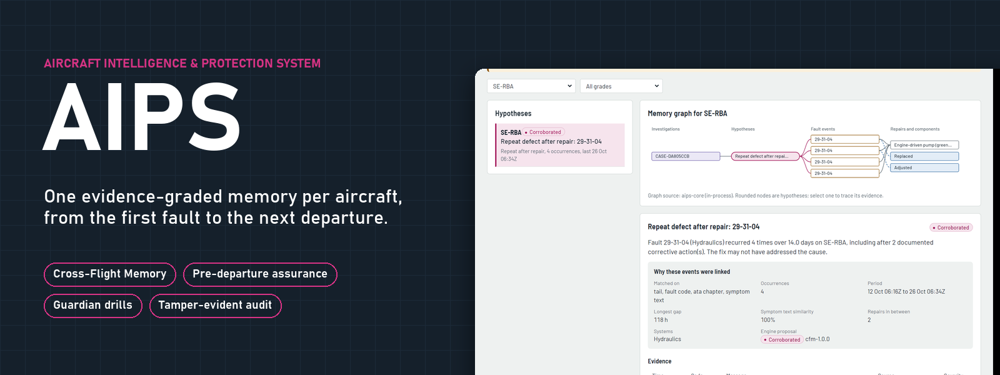
</p>

<p align="center">
  <a href="https://www.rust-lang.org/"></a>
  <a href="libs/aips-signal"></a>
  <a href="apps/command"></a>
  <a href="apps/command"></a>
  <a href="services/aips-core/src/bus.rs"></a>
  <a href="workers/temporal"></a>
  <a href="deploy/keycloak"></a>
</p>

<h3 align="center">Prevent what can be prevented. Detect what goes wrong. Respond when people cannot.</h3>

Today, everything known about one aircraft is split across the airline, the MRO, the lessor and the
manufacturer. A fault is logged in one system, the repair in another, and when the same fault comes
back three flights later, nobody has the whole picture in front of them.

**AIPS gives every aircraft one long-term memory.** It joins health data, maintenance history and
flight records per tail number, notices when a "fixed" defect returns, opens the investigation
automatically, and puts the evidence in front of the right engineer before the next departure. It
also rehearses the worst case: an onboard emergency where nobody answers, with escalation that
does not depend on a single person or channel.

> **Advisory platform, demonstrated on synthetic data.** AIPS never controls an aircraft and never
> approves or denies a departure. Every operator, registration, part number and serial in this
> repository is fictional.

<p align="center">
  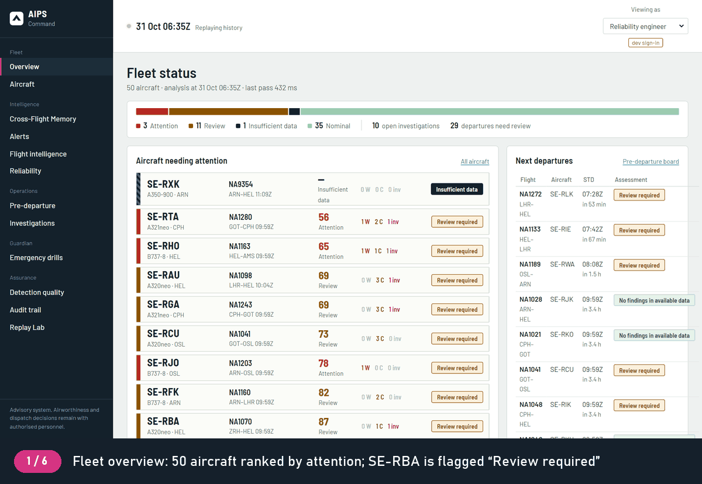
  <br><sub>Six steps, one aircraft: the repeat-defect story below, recorded from the running app.</sub>
</p>

---

## Contents

- [The problem](#the-problem)
- [See it work: one defect, end to end](#see-it-work-one-defect-end-to-end)
- [What each feature does](#what-each-feature-does)
- [Who it is for](#who-it-is-for)
- [Measured results](#measured-results)
- [Design principles](#design-principles)
- [Architecture](#architecture) · [Tech stack](#tech-stack) · [Quick start](#quick-start) · [Documentation](#documentation) · [Roadmap](#roadmap)

## The problem

| What goes wrong today | What AIPS does about it |
|---|---|
| **Fragmented history.** A fault, its repair and its return sit in different systems, so repeat defects are found late. | **Cross-Flight Memory** links every new fault to the aircraft's past faults and repairs, and flags a defect that returns after a documented fix. |
| **Late recognition before departure.** Open defects, MEL items and recent anomalies are reviewed by hand, differently each time. | **Pre-departure assurance** builds the same nine-category evidence report for every flight, ranked by severity, with the age of every data source. |
| **Single points of failure in an emergency.** One pilot, one crew member or one channel may be the only way an emergency gets noticed. | **Guardian** combines independent indicators, notifies crew on two channels, tracks who answered, and escalates when nobody does. |
| **Manual paperwork.** Follow-ups, case assignment and closure evidence are repetitive and easy to drop. | **Durable workflows** open cases, run their deadlines and escalate on time, even across restarts. |

**Why existing tools don't cover this.** Manufacturer platforms such as Airbus Skywise and Boeing
Airplane Health Management are strong at health monitoring, but each centres on its own aircraft. Certified
autoland systems such as Garmin Autoland cover small aircraft only, and none of them adds a ground coordination
layer. AIPS is designed as a **neutral, multi-manufacturer record** that airlines, MROs and lessors can share under
permissions, with evidence-graded reasoning and emergency coordination built in. (Competitor details are from the
[PRD's market research](docs/PRD.md#3-competitive-landscape).)

## See it work: one defect, end to end

The Replay Lab replays 50 aircraft with injected fault scenarios. Here is one of them, exactly as the
app shows it: **aircraft SE-RBA, an A320neo, has a hydraulic reservoir warning that keeps coming back.**

### 1. The fleet view flags the aircraft

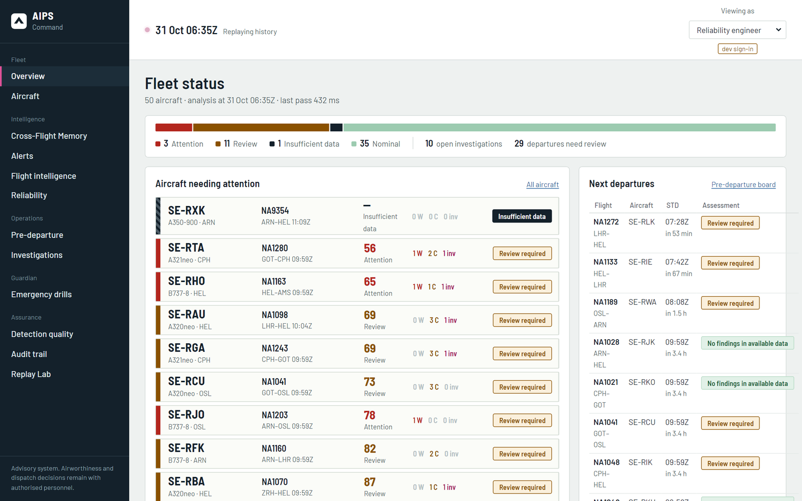

The control room opens on the whole fleet: 50 aircraft, ranked by how much attention each needs.
SE-RBA reads **Review required**. Next to it, the upcoming departures show which flights need a look
before they leave. An aircraft whose data is stale shows **Insufficient data**, never a reassuring green.

### 2. The aircraft page shows where the problem is

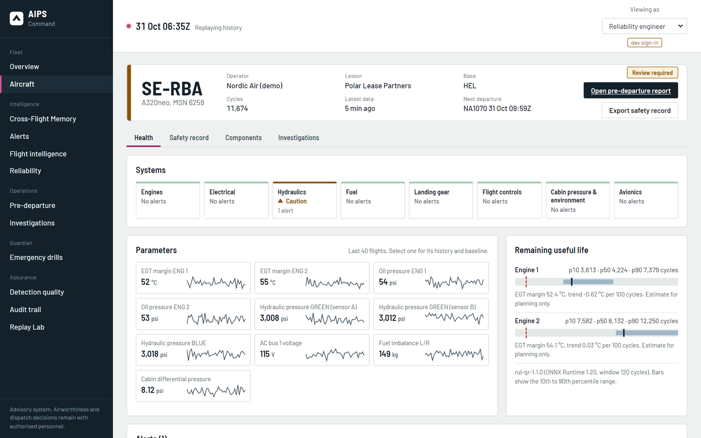

Every system has its own tile. **Hydraulics shows a Caution**. The parameter sparklines cover the
last 40 flights, and each engine's remaining useful life is shown as a range (10th to 90th
percentile), never a single falsely precise number. The alert at the bottom can be acknowledged and
rated *Useful* or *Not useful*. Those ratings are how AIPS measures its own precision.

### 3. Cross-Flight Memory explains the link

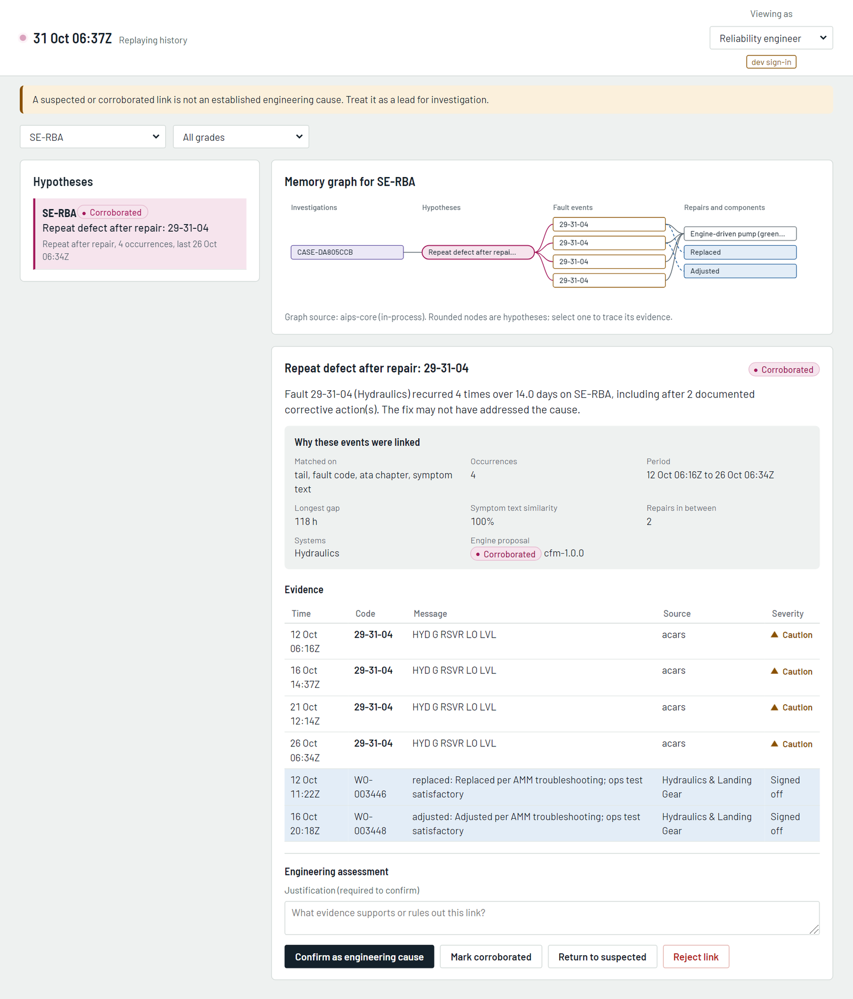

This is the core of the product. Fault **29-31-04 (HYD G RSVR LO LVL)** was reported **4 times in 14
days**. In between, the engine-driven pump was **replaced** and then **adjusted**, and both work
orders were signed off. AIPS concludes *"the fix may not have addressed the cause"* and shows exactly
**why** it linked the events: same tail, fault code, ATA chapter and symptom text, a 118-hour longest
gap, and 2 repairs in between.

The link is graded **Corroborated**, not "confirmed". Only an engineer can promote it to
*Engineering-confirmed*, and that requires a written justification.

### 4. An investigation opens on its own

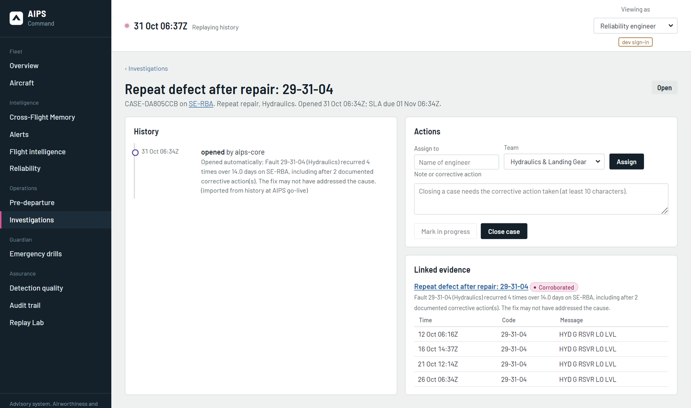

The recurrence crossed the threshold, so AIPS opened **CASE-DA805CCB**, assigned it to Hydraulics &
Landing Gear, set an SLA deadline, and attached the evidence. A Temporal workflow escalates the case
if the deadline passes. Closing a case requires the corrective action taken, in writing.

### 5. The pre-departure report puts it first

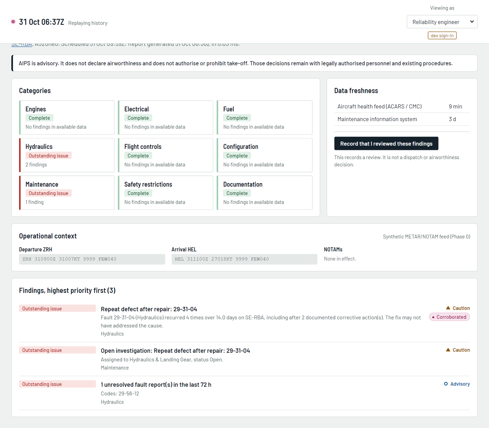

Before flight **NA1070 ZRH-HEL**, AIPS assembles nine evidence categories: engines, electrical, fuel,
hydraulics, flight controls, configuration, maintenance, restrictions and documentation. Hydraulics
and Maintenance show **Outstanding issue**, and the findings are ranked with the repeat defect first.
Every source shows its data age, and the weather and NOTAMs for both airports are attached. The banner is
explicit: **AIPS does not declare airworthiness or authorise take-off.**

### 6. Every decision is on the record

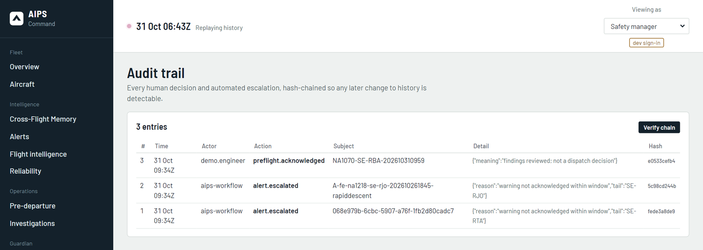

When the engineer records the review, it lands in the **hash-chained audit trail**, recorded as *"findings
reviewed; not a dispatch decision"*. Automated escalations sit in the same chain. **Verify chain**
recomputes every hash, so any later edit to history is detectable.

**From a recurring fault to a reviewed, auditable decision, without anyone having to remember the
aircraft's history.**

## What each feature does

### Aircraft health and remaining life (AIPS Integrity and Predict)

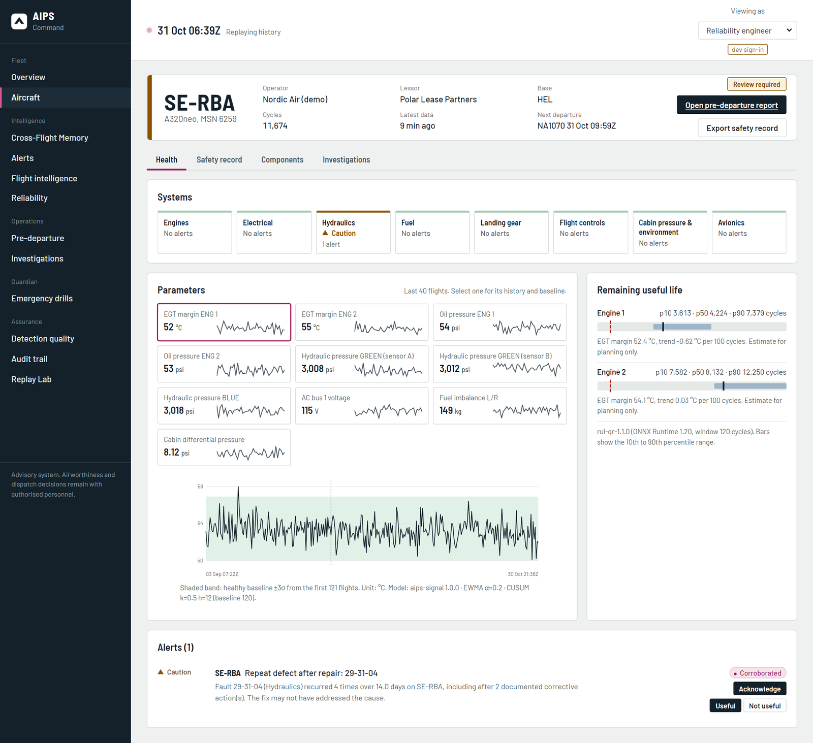

**What it does:** watches every monitored parameter (EGT margin, oil and hydraulic pressure, bus
voltage, fuel imbalance, cabin differential pressure) against a baseline learned for *that* tail number.
It flags drift (CUSUM), sudden change (EWMA), frozen or out-of-range sensors, and redundant sensors that
disagree. It also estimates remaining useful life with an uncertainty band.

**Why it matters:** a slow trend is visible weeks before it becomes a fault message. The signal code is
C++17, fuzzed under AddressSanitizer and UndefinedBehaviorSanitizer, and the life model runs in ONNX Runtime.

### Alerts that explain themselves

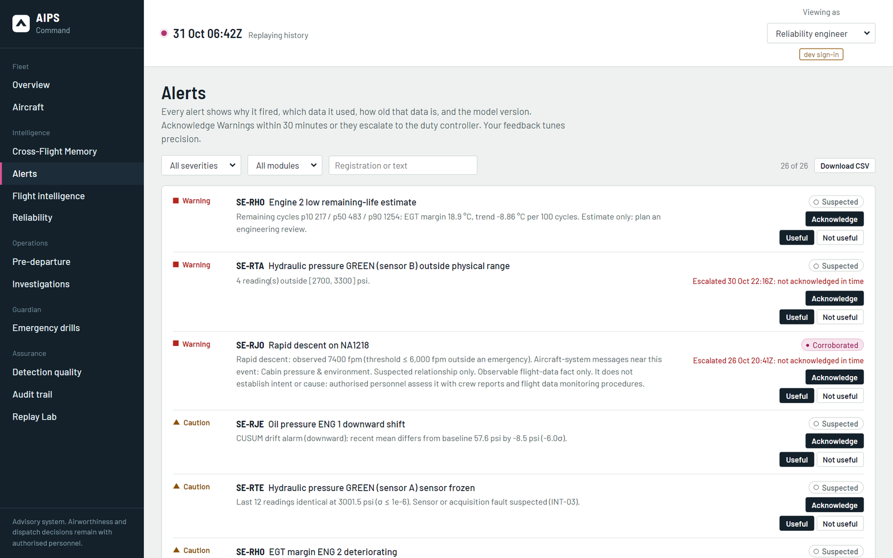

**What it does:** every alert shows its source data, data age, model version and the reason it fired.
Each alert carries an evidence grade and can be acknowledged, then rated useful or not. A Warning that
nobody acknowledges within 30 minutes escalates to the duty controller.

**Why it matters:** alert fatigue is the main reason monitoring tools get ignored. AIPS measures its own
precision from engineers' ratings and shows that number in the product.

### Flight intelligence (AIPS Flight)

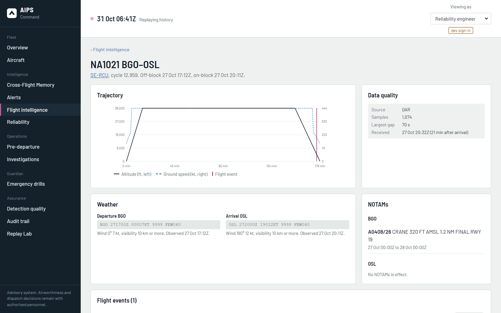

**What it does:** plots each flight's altitude and speed, flags observable anomalies such as a rapid
descent, correlates them with aircraft-system events, weather and NOTAMs, and writes a post-flight safety
summary that updates the aircraft record.

**Why it matters:** it shows what happened on the flight, not a guess at why. AIPS never infers intent.

### Fleet reliability

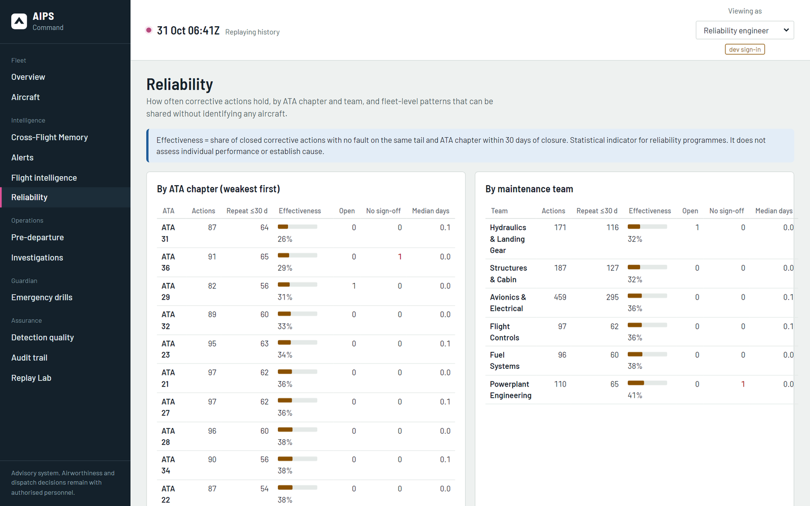

**What it does:** ranks ATA chapters and maintenance teams by **effectiveness**, the share of corrective
actions that did *not* see the same fault return within 30 days.

**Why it matters:** it shows which repairs aren't sticking across the whole fleet, so reliability
engineers know where to look first.

### Guardian emergency drills

<table>
<tr>
<td width="50%">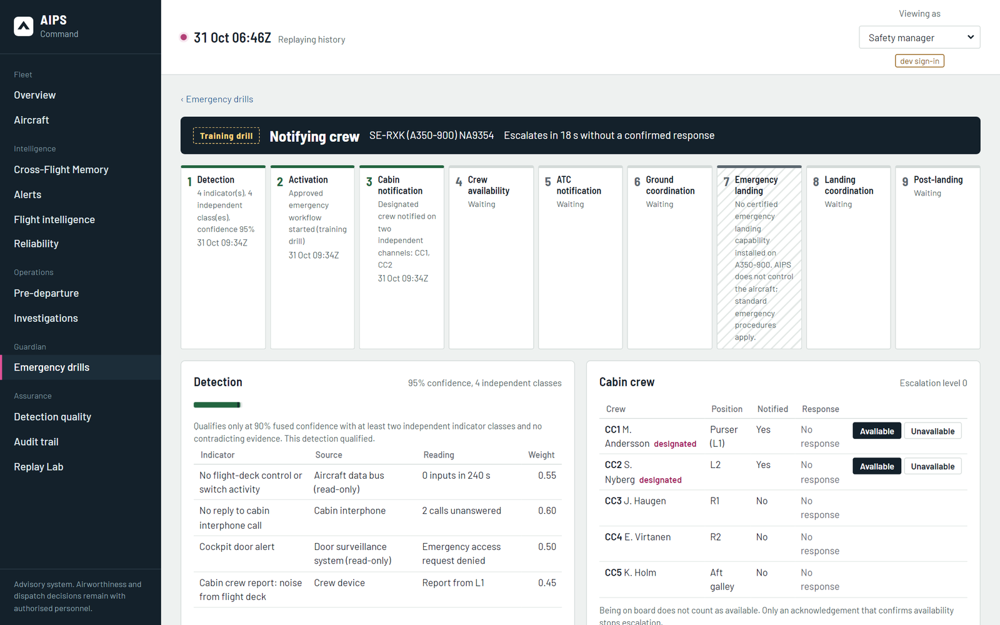</td>
<td width="50%">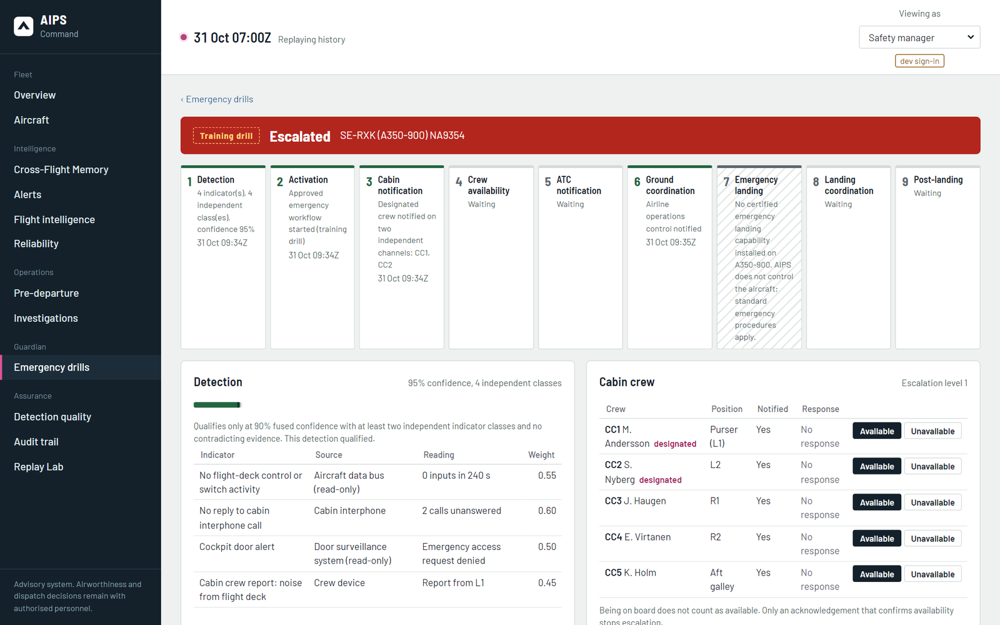</td>
</tr>
<tr>
<td><b>Seconds in:</b> four independent indicators fused at 95% confidence. Designated crew notified on two independent channels.</td>
<td><b>30 seconds later:</b> nobody acknowledged, so the drill escalates to more crew and to operations.</td>
</tr>
</table>

**What it does:** rehearses the nine-stage emergency response from the PRD, from detection to post-landing.
Detection needs at least two independent classes of indicator, and it shows every indicator with its
weight. Crew must actively confirm they are available. Being on board does not count as available.

**Why it matters:** it removes the single point of failure. It runs as a **separate deployment with its own
database and a local tamper-evident journal**, so it keeps working if the analytics platform is down.
Drills are clearly marked and cannot notify real recipients or ATC. AIPS never triggers a landing function.

### Digital safety record (AIPS Passport)

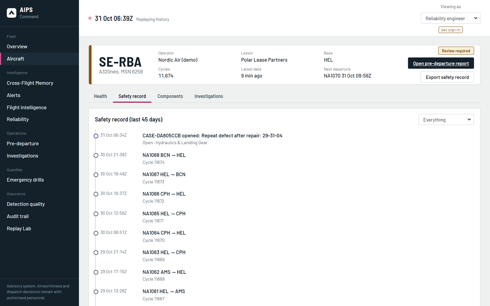

**What it does:** keeps an append-only history per aircraft covering flights, faults, work orders, cases,
assessments and data quality. Every entry records its source, author, time and evidence grade.
Corrections are versioned, never overwritten, and the record exports in an open format.

**Why it matters:** at lease return or sale, the aircraft's history moves with it, and anyone can check
where each entry came from.

### Data isolation between organisations

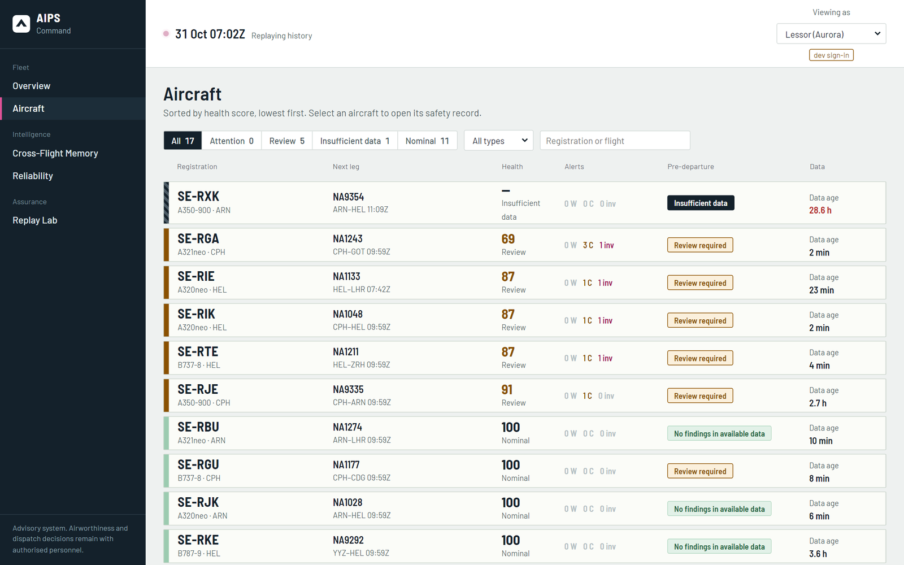

**What it does:** the same app, signed in as a lessor, shows **only that lessor's aircraft**. Access is
role-based with least privilege, Keycloak single sign-on and enforced MFA. Erasing data requires two people.

**Why it matters:** airlines, MROs and lessors can share one record without seeing each other's data.

### Detection quality, measured in the product

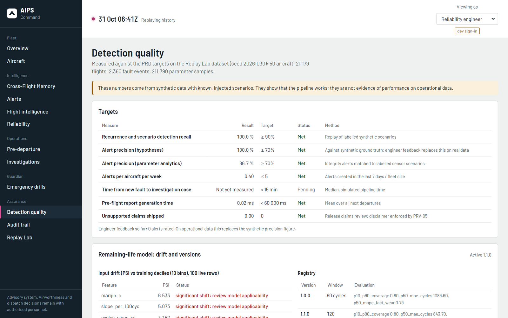

**What it does:** scores AIPS against the PRD's targets on every run, including recall, precision, alerts per
aircraft per week and report time. It also tracks input drift and version history for the remaining-life model.

**Why it matters:** a safety tool should show how well it is working. The page also states its own
limit: these figures come from synthetic data.

### Replay Lab

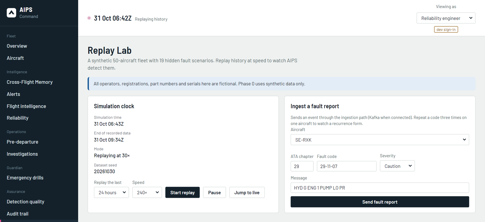

**What it does:** generates a 50-aircraft synthetic fleet with injected, labelled fault scenarios and
replays it at up to 3,600× speed. You can inject your own fault report and watch it flow through the pipeline.

**Why it matters:** every claim on this page can be reproduced on your machine, with no airline data needed.

## Who it is for

| Role | What AIPS gives them |
|---|---|
| Reliability or fleet engineer | Repeat and related defects, with the evidence to confirm or reject each link |
| Maintenance control (MCC) | One alert queue, automatic cases, SLA escalation |
| Flight operations and dispatch | A consistent pre-departure evidence report for every flight |
| Safety and quality manager | Hash-chained audit trail, emergency drill results, detection quality |
| Lessor technical representative | A verifiable safety record limited to their own aircraft |
| MRO planner | Repair effectiveness by ATA chapter and team |
| Cabin crew (drills) | Two-channel notification and a simple acknowledgement |

## Measured results

Measured on the Replay Lab dataset (50 aircraft, about 21,000 flights) on the in-app *Detection quality*
page, against the PRD's proposed targets:

| Measure | Result | PRD target |
|---|---|---|
| Recurrence and scenario detection recall | **100%** | ≥ 90% |
| Alert precision (hypotheses) | **100%** | ≥ 70% |
| Alert precision (parameter analytics) | **86.7%** | ≥ 70% |
| Alerts per aircraft per week | **0.40** | ≤ 5 |
| Pre-departure report generation | **0.02 ms** | < 60 s |

From the earlier engineering runs:

| Result | Value | Source |
|---|---|---|
| PRD requirements implemented and verified | **76 / 95** | [Requirements trace](docs/REQUIREMENTS_TRACE.md) |
| Labelled replay scenarios detected | **19 / 19** | [Engineering report](docs/ENGINEERING_REPORT.md) |
| Read throughput, 50-aircraft fleet | **2,400+ req/s**, zero errors | [Performance report](docs/ENGINEERING_REPORT.md#d-performance-report) |
| Fleet scale exercised | **500 aircraft**, 212,717 flights, 2.1 M samples | [Performance report](docs/ENGINEERING_REPORT.md#d-performance-report) |

> These figures come from synthetic data with known, injected scenarios. They show the pipeline works;
> they are not evidence of performance on operational data.

## Design principles

AIPS informs authorised people and records evidence. These boundaries are part of the design:

| Principle | In the product |
|---|---|
| Human authority | No approve or deny action exists; airworthiness and dispatch stay with authorised people |
| Evidence before assertion | A correlation is never presented as a root cause |
| Fail safe and visible | Missing or stale data is shown loudly, never as a silent "all clear" |
| No aircraft control | AIPS never commands an aircraft system or the cockpit door, and never triggers a landing function |
| Observable events only | No face recognition, no appearance-based classification, no intent inference |
| Training-only emergencies | Drills run in a marked training mode that cannot notify real recipients or ATC |

## Architecture

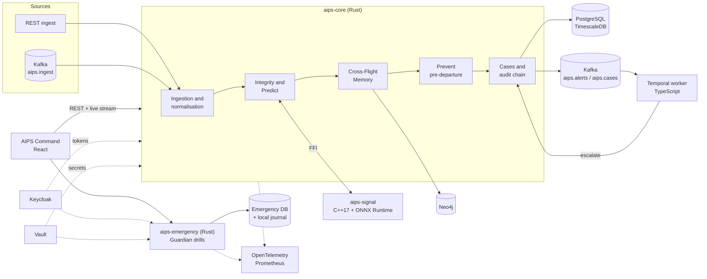

The emergency path runs as its own deployment with its own data store, so it keeps working when
the analytics platform or its database is unavailable.

## Tech stack

| Layer | Technology |
|---|---|
| Services | Rust (axum, tokio, sqlx), the intelligence core and the Guardian emergency service |
| Signal processing | C++17 with ONNX Runtime 1.20; optional CUDA batch kernel |
| Web | React and TypeScript (strict), Vite |
| Workflows | Temporal with a TypeScript worker |
| Events | Apache Kafka |
| Data | PostgreSQL 16 with TimescaleDB; Neo4j for the relationship graph |
| Identity and secrets | Keycloak (OIDC, PKCE, TOTP MFA); HashiCorp Vault |
| Observability | OpenTelemetry, Prometheus, Grafana |
| Delivery | Docker, Docker Compose, Kubernetes; CI with SBOMs, image scanning, signing and provenance |
| Models | Python for training and evaluation only; inference runs in ONNX Runtime |

## Quick start

**Full stack** (TimescaleDB, Neo4j, Kafka, Temporal, Keycloak, Vault, OpenTelemetry and the three
AIPS services):

```bash
docker compose -f deploy/docker-compose.yml up --build
# AIPS Command: http://localhost:8090   Keycloak: http://localhost:8081   Temporal UI: http://localhost:8233
# add --profile observability for Prometheus (9090) and Grafana (3000)
```

**Local development** (Rust 1.89+, CMake 3.20+, a C++17 compiler, Node 22, and the
[ONNX Runtime 1.20.1](https://github.com/microsoft/onnxruntime/releases/tag/v1.20.1) Linux release
unpacked in `third_party/`):

```bash
cargo build --release
(cd apps/command && npm ci && npm run build)
AIPS_AUTH_MODE=dev ./target/release/aips-core        # http://localhost:8090
AIPS_AUTH_MODE=dev ./target/release/aips-emergency   # http://localhost:8091
```

Dev mode takes the role from a header and shows a "Viewing as" switcher in the UI. It starts only
when `AIPS_ENV` is `development` (the default), `local`, `test` or `ci`. Set `DATABASE_URL` to
persist data and decisions across restarts.

**Tests:**

```bash
cargo test --release --workspace                         # unit and property-based tests
(cd workers/temporal && npm ci && npm test)              # workflow logic (set TEMPORAL_CLI for real-server tests)
node tests/integration/api.mjs                           # API integration (services running)
node tests/integration/concurrency.mjs                   # races and audit-chain integrity
NODE_PATH=$(npm root -g) node tests/a11y/axe-audit.mjs   # WCAG A/AA automated audit
NODE_PATH=$(npm root -g) node tests/e2e/ui-smoke.mjs     # every screen, as each role
```

To regenerate the README images, run the stack in dev mode, then
`node tests/e2e/readme-media.mjs <url> <rawDir>` and `python tests/e2e/compose_readme_media.py <rawDir>`.

The full list, including security, reliability, performance and live-infrastructure suites, is in
[`docs/OPERATIONS.md`](docs/OPERATIONS.md) and [`.github/workflows/ci.yml`](.github/workflows/ci.yml).

## Repository layout

| Path | What it is |
|---|---|
| `services/aips-core` | Intelligence core and AIPS Command API; also serves the UI |
| `services/aips-emergency` | Guardian emergency workflow service (separate deployment) |
| `libs/aips-signal` | C++ signal analytics and ONNX Runtime inference |
| `crates/` | Domain logic, synthetic Replay Lab, shared platform code, FFI bindings |
| `apps/command` | AIPS Command web UI |
| `workers/temporal` | Temporal worker for durable escalation |
| `ml/` | RUL model training and evaluation |
| `db/migrations` | Additive SQL migrations |
| `deploy/` | Dockerfiles, Compose stack, Kubernetes manifests, Keycloak realm, observability config |
| `tests/` | Integration, live-infrastructure, security, reliability, accessibility, end-to-end and performance suites |

## Documentation

- [Product requirements (PRD)](docs/PRD.md)
- [Engineering report](docs/ENGINEERING_REPORT.md) and [requirements trace](docs/REQUIREMENTS_TRACE.md)
- [Technical audit](docs/TECHNICAL_AUDIT.md), [threat model](docs/THREAT_MODEL.md) and [hazard analysis](docs/HAZARD_ANALYSIS.md)
- [Regulatory position](docs/REGULATORY_POSITION.md) and [assumptions](docs/ASSUMPTIONS.md)
- [API](docs/API.md) and [operations](docs/OPERATIONS.md)

## Roadmap

Phase 0 proves the pipeline on synthetic data. Next steps:

- **Real data.** Airline and OEM connectors, live METAR and NOTAM feeds, and design-partner
  datasets to replace the synthetic Replay Lab.
- **Data sharing.** Cross-customer opt-in fleet patterns, and per-field ownership controls beyond
  lessor redaction.
- **High availability.** A replicated core with region and node failure drills, long-run
  availability measurement, and verified encryption at rest with key rotation.
- **Guardian on aircraft.** Approved cockpit-door and cabin-event interfaces, real notification
  channels with measured delivery latency, and crew identity bound to acknowledgements.
- **Assurance.** A DO-326A / DO-355 aligned security process, an independent penetration test, a
  manual WCAG 2.2 accessibility audit, an externally anchored audit chain, and safety-lead approval
  of each model release.
- **Scale.** Paginated history endpoints and incremental analysis for very large fleets.
- **Autoland integration (Phase 8).** Forwarding to certified emergency landing systems, led by an
  OEM partner.
