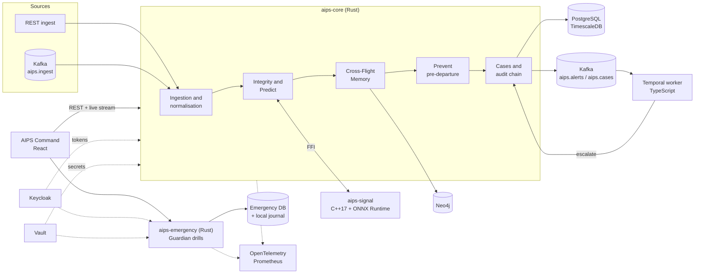
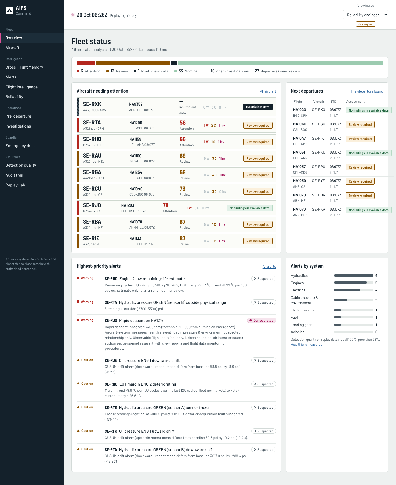
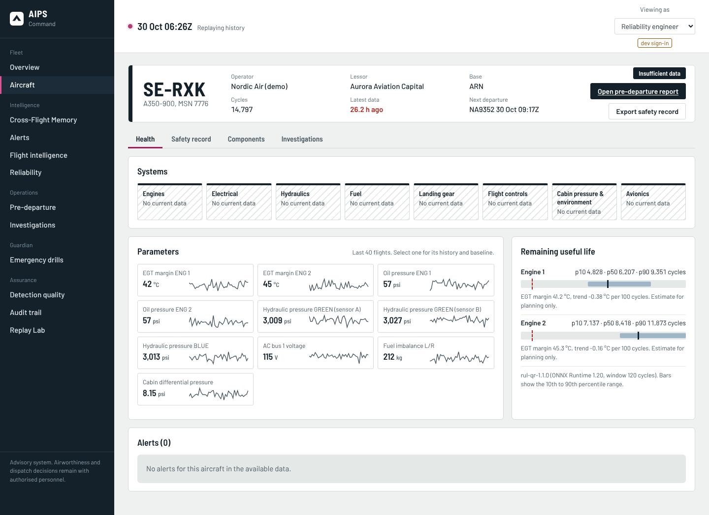
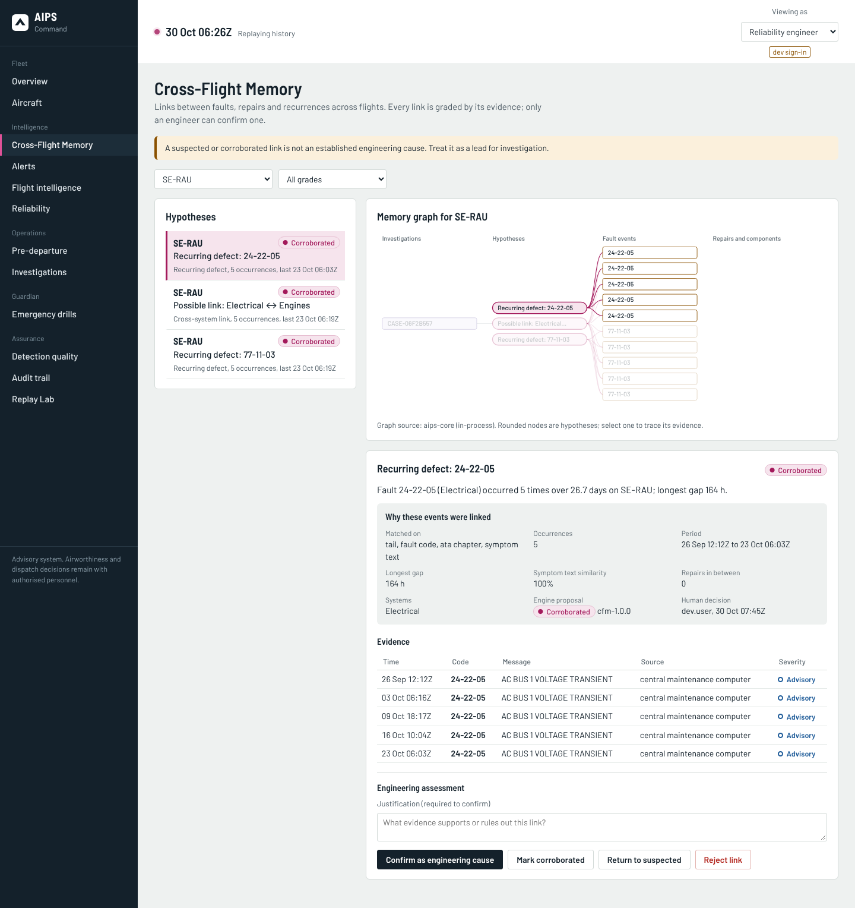
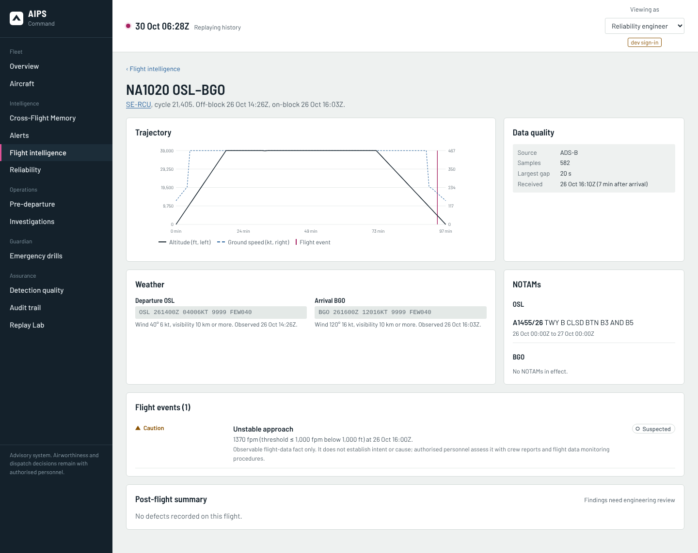
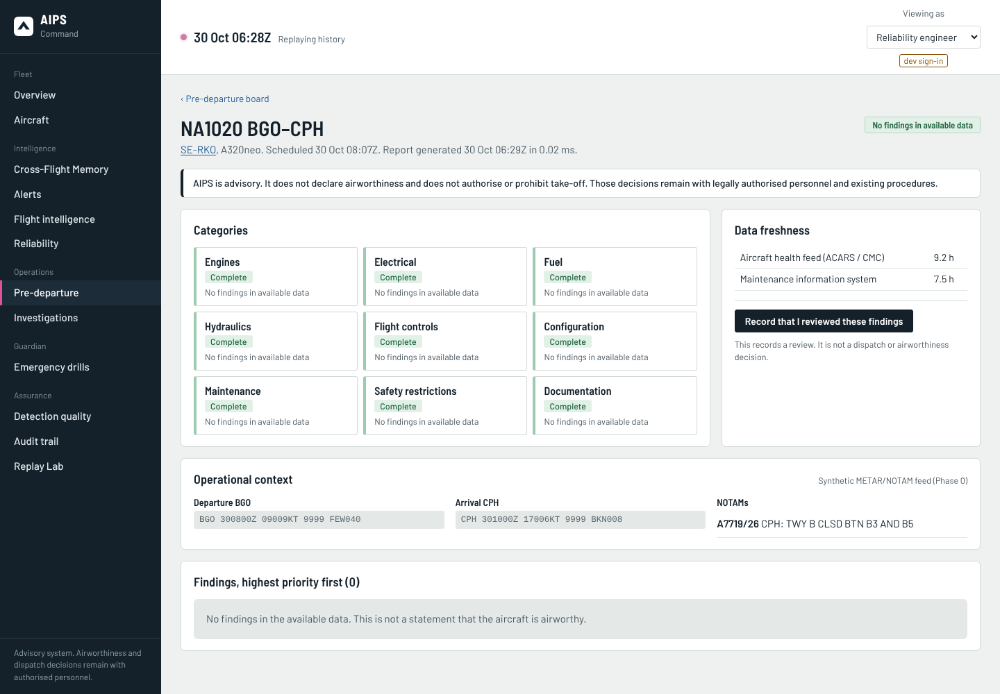
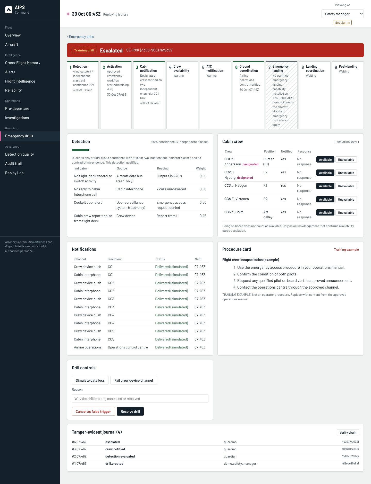

# AIPS — Aircraft Intelligence & Protection System

**One long-term, evidence-graded memory per aircraft: from the first fault to the next departure.**

[](https://www.rust-lang.org/)
[](libs/aips-signal)
[](apps/command)
[](apps/command)
[](services/aips-core/src/bus.rs)
[](workers/temporal)
[](deploy/keycloak)

AIPS joins aircraft health data, maintenance history and flight records into a single record per
tail number. It recognises recurring and related defects across flights, assembles an
evidence-graded pre-departure report for every flight, opens and escalates investigations, and
rehearses onboard emergency coordination with crew acknowledgement tracking.

> **Advisory platform, demonstrated on synthetic data.** Every operator, registration, part number
> and serial in this repository is fictional.

---

## Highlights

- **Cross-Flight Memory.** Matches each new fault against the aircraft's history by fault code, ATA
  chapter, symptom text and parameter signature, flags recurrence after a documented fix, and
  explains every link it makes.
- **Evidence before assertion.** Every finding carries an evidence grade (Suspected, Corroborated,
  Engineering-confirmed), its sources and their data age. Only an engineer can confirm a cause.
- **Pre-departure assurance.** Nine evidence categories per flight, ranked by status, severity and
  grade, with data freshness for every source. Stale data always reads "Insufficient data".
- **Signal analytics in C++.** EWMA, CUSUM drift, frozen and out-of-range sensors and redundant-sensor
  disagreement, plus remaining-useful-life inference with uncertainty bands through ONNX Runtime.
  The C++ is fuzzed under AddressSanitizer and UndefinedBehaviorSanitizer.
- **Durable escalation.** Investigation SLAs and pre-departure concerns run as Temporal workflows
  started from Kafka, so a restart never loses a pending step.
- **Guardian emergency drills.** Multi-indicator detection with confidence, notification on two
  independent channels, per-crew acknowledgement and escalation, on a separate deployment with its
  own data store and a tamper-evident journal.
- **Tamper-evident audit.** Every decision, acknowledgement, override and model change is
  hash-chained and append-only.
- **Secure by default.** Keycloak SSO with enforced MFA, strict JWT validation, role-based access
  with lessor isolation, a TLS 1.3-only listener, two-person data erasure, and hardened Kubernetes
  manifests.

## Design principles

AIPS informs authorised people and records evidence. These boundaries are part of the design:

| Principle | In the product |
|---|---|
| Human authority | No approve or deny action exists; airworthiness and dispatch stay with authorised people |
| Evidence before assertion | A correlation is never presented as a root cause |
| Fail safe and visible | Missing or stale data is shown loudly, never as a silent "all clear" |
| No aircraft control | AIPS never commands an aircraft system or the cockpit door, and never triggers a landing function |
| Observable events only | No face recognition, no appearance-based classification, no intent inference |
| Training-only emergencies | Drills run in a marked training mode that cannot notify real recipients or ATC |

## Key results

| Result | Value | Source |
|---|---|---|
| PRD requirements implemented and verified | **76 / 95** | [Requirements trace](docs/REQUIREMENTS_TRACE.md) |
| Labelled replay scenarios detected | **19 / 19** | [Engineering report](docs/ENGINEERING_REPORT.md) |
| Read throughput, 50-aircraft fleet | **2,400+ req/s**, zero errors | [Performance report](docs/ENGINEERING_REPORT.md#d-performance-report) |
| Fleet scale exercised | **500 aircraft**, 212,717 flights, 2.1 M samples | [Performance report](docs/ENGINEERING_REPORT.md#d-performance-report) |
| Failed tests in the pre-push run | **0** | Rust, C++, TypeScript, integration, security, reliability, accessibility, end-to-end |

## Architecture



The emergency path runs as its own deployment with its own data store, so it keeps working when
the analytics platform or its database is unavailable.

## Gallery

| | |
|---|---|
|  **Fleet overview** |  **Aircraft health and remaining life** |
|  **Cross-Flight Memory graph** |  **Flight timeline and events** |
|  **Pre-departure report** |  **Guardian drill with escalation** |

## Tech stack

| Layer | Technology |
|---|---|
| Services | Rust (axum, tokio, sqlx), the intelligence core and the Guardian emergency service |
| Signal processing | C++17 with ONNX Runtime 1.20; optional CUDA batch kernel |
| Web | React and TypeScript (strict), Vite |
| Workflows | Temporal with a TypeScript worker |
| Events | Apache Kafka |
| Data | PostgreSQL 16 with TimescaleDB; Neo4j for the relationship graph |
| Identity and secrets | Keycloak (OIDC, PKCE, TOTP MFA); HashiCorp Vault |
| Observability | OpenTelemetry, Prometheus, Grafana |
| Delivery | Docker, Docker Compose, Kubernetes; CI with SBOMs, image scanning, signing and provenance |
| Models | Python for training and evaluation only; inference runs in ONNX Runtime |

## Quick start

**Full stack** (TimescaleDB, Neo4j, Kafka, Temporal, Keycloak, Vault, OpenTelemetry and the three
AIPS services):

```bash
docker compose -f deploy/docker-compose.yml up --build
# AIPS Command: http://localhost:8090   Keycloak: http://localhost:8081   Temporal UI: http://localhost:8233
# add --profile observability for Prometheus (9090) and Grafana (3000)
```

**Local development** (Rust 1.89+, CMake 3.20+, a C++17 compiler, Node 22, and the
[ONNX Runtime 1.20.1](https://github.com/microsoft/onnxruntime/releases/tag/v1.20.1) Linux release
unpacked in `third_party/`):

```bash
cargo build --release
(cd apps/command && npm ci && npm run build)
AIPS_AUTH_MODE=dev ./target/release/aips-core        # http://localhost:8090
AIPS_AUTH_MODE=dev ./target/release/aips-emergency   # http://localhost:8091
```

Dev mode takes the role from a header and shows a "Viewing as" switcher in the UI. It starts only
when `AIPS_ENV` is `development` (the default), `local`, `test` or `ci`. Set `DATABASE_URL` to
persist data and decisions across restarts.

**Tests:**

```bash
cargo test --release --workspace                         # unit and property-based tests
(cd workers/temporal && npm ci && npm test)              # workflow logic (set TEMPORAL_CLI for real-server tests)
node tests/integration/api.mjs                           # API integration (services running)
node tests/integration/concurrency.mjs                   # races and audit-chain integrity
NODE_PATH=$(npm root -g) node tests/a11y/axe-audit.mjs   # WCAG A/AA automated audit
NODE_PATH=$(npm root -g) node tests/e2e/ui-smoke.mjs     # every screen, as each role
```

The full list, including security, reliability, performance and live-infrastructure suites, is in
[`docs/OPERATIONS.md`](docs/OPERATIONS.md) and [`.github/workflows/ci.yml`](.github/workflows/ci.yml).

## Repository layout

| Path | What it is |
|---|---|
| `services/aips-core` | Intelligence core and AIPS Command API; also serves the UI |
| `services/aips-emergency` | Guardian emergency workflow service (separate deployment) |
| `libs/aips-signal` | C++ signal analytics and ONNX Runtime inference |
| `crates/` | Domain logic, synthetic Replay Lab, shared platform code, FFI bindings |
| `apps/command` | AIPS Command web UI |
| `workers/temporal` | Temporal worker for durable escalation |
| `ml/` | RUL model training and evaluation |
| `db/migrations` | Additive SQL migrations |
| `deploy/` | Dockerfiles, Compose stack, Kubernetes manifests, Keycloak realm, observability config |
| `tests/` | Integration, live-infrastructure, security, reliability, accessibility, end-to-end and performance suites |

## Documentation

- [Product requirements (PRD)](docs/PRD.md)
- [Engineering report](docs/ENGINEERING_REPORT.md) and [requirements trace](docs/REQUIREMENTS_TRACE.md)
- [Technical audit](docs/TECHNICAL_AUDIT.md), [threat model](docs/THREAT_MODEL.md) and [hazard analysis](docs/HAZARD_ANALYSIS.md)
- [Regulatory position](docs/REGULATORY_POSITION.md) and [assumptions](docs/ASSUMPTIONS.md)
- [API](docs/API.md) and [operations](docs/OPERATIONS.md)

## Roadmap

Phase 0 proves the pipeline on synthetic data. Next steps:

- **Real data.** Airline and OEM connectors, live METAR and NOTAM feeds, and design-partner
  datasets to replace the synthetic Replay Lab.
- **Data sharing.** Cross-customer opt-in fleet patterns, and per-field ownership controls beyond
  lessor redaction.
- **High availability.** A replicated core with region and node failure drills, long-run
  availability measurement, and verified encryption at rest with key rotation.
- **Guardian on aircraft.** Approved cockpit-door and cabin-event interfaces, real notification
  channels with measured delivery latency, and crew identity bound to acknowledgements.
- **Assurance.** A DO-326A / DO-355 aligned security process, an independent penetration test, a
  manual WCAG 2.2 accessibility audit, an externally anchored audit chain, and safety-lead approval
  of each model release.
- **Scale.** Paginated history endpoints and incremental analysis for very large fleets.
- **Autoland integration (Phase 8).** Forwarding to certified emergency landing systems, led by an
  OEM partner.
